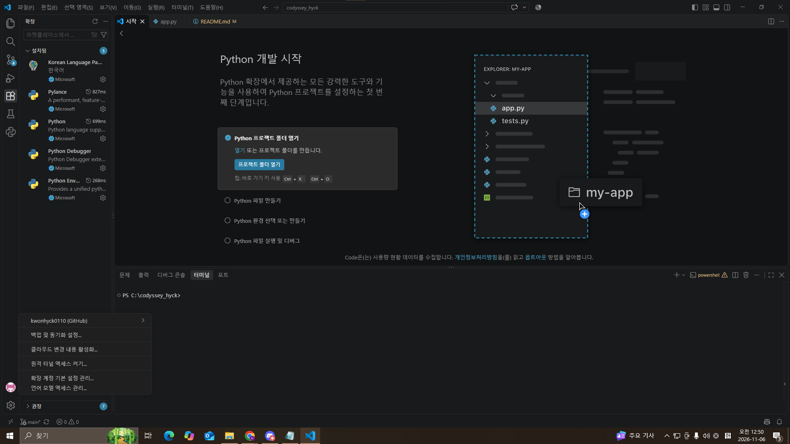
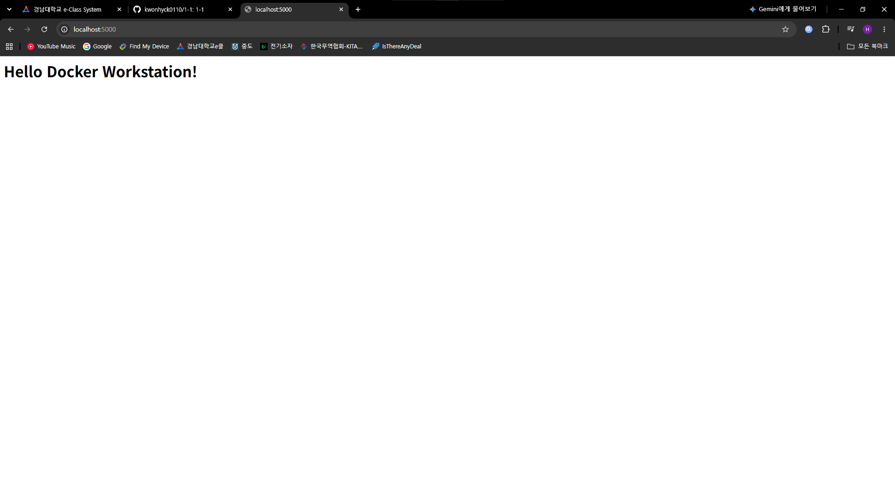
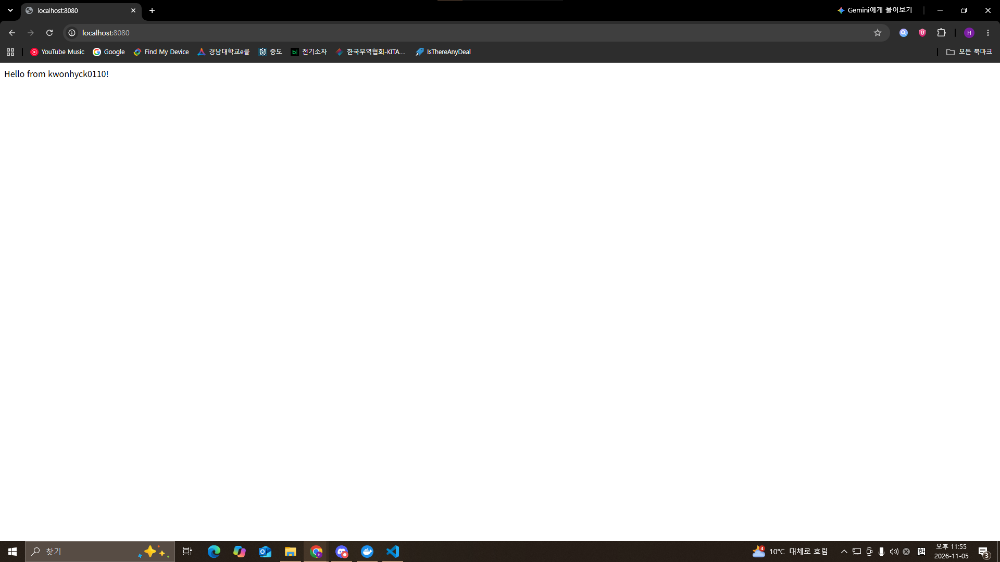
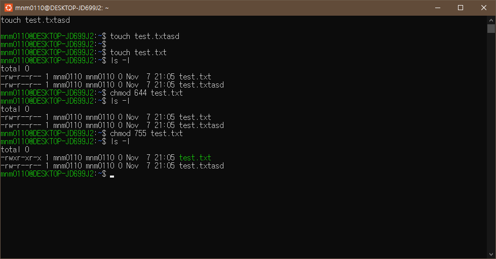
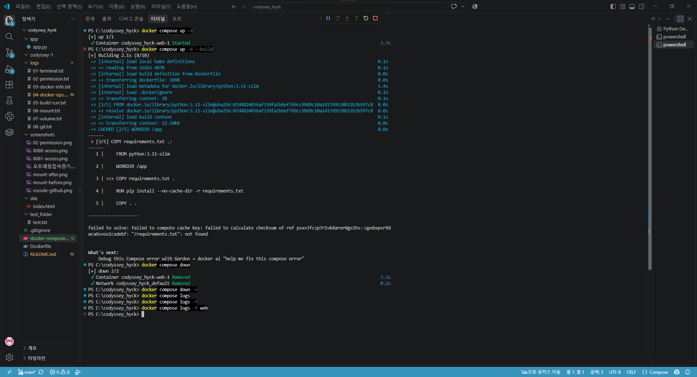

<<<<<<< HEAD
# codyssey-1
1-1과제 나만의 작업실 꾸미기
# Docker 워크스테이션 구축 과제

## 1) 프로젝트 개요
Linux 터미널 기본 조작부터 Docker 기반 웹서버 배포,
Git/GitHub 연동까지 개발 워크스테이션 환경을 구축한다.

## 2) 실행 환경
- OS: WSL 버전: 3.0.3.0 lynx, Ubuntu 26.04.1
- Shell: PowerShell , bash
- Docker: (Docker version 29.9.2)
- Git: (git version 2.56.0.windows.4)

  

## 3) 수행 체크리스트
- [x] 터미널 기본 조작 → [logs/01-terminal.txt](./logs/01-terminal.txt)
- [x] 권한 변경 실습 → [logs/02-permission.txt](./logs/02-permission.txt)
- [x] Docker 설치/점검 → [logs/03-docker-info.txt](./logs/03-docker-info.txt)
- [x] Docker 운영 명령/Hello World → [logs/04-docker-ops.txt](./logs/04-docker-ops.txt)
- [x] Dockerfile 빌드/실행 → [logs/05-build-run.txt](./logs/05-build-run.txt)
- [x] 포트 매핑 접속 2회 → [screenshots/](./screenshots/)
- [x] 바인드 마운트 반영 → [logs/06-mount.txt](./logs/06-mount.txt)
- [x] 볼륨 영속성 → [logs/07-volume.txt](./logs/07-volume.txt)
- [x] Git/GitHub 연동 → [logs/08-git.txt](./logs/08-git.txt)

## 4) 검증 방법
### Docker 버전 확인
```bash
$ docker --version
Docker version 29.9.2, build a82e528
```

## 5) 볼륨(데이터 영속성) 구성
### 사용한 볼륨 정보
| 항목 | 값 |
|------|-----|
| 볼륨 이름 | mydata |
| 마운트 경로(컨테이너 내부) | /data |
| 테스트 이미지 | ubuntu |

### 재현 명령 (데이터 영속성 검증 절차)
```powershell
# 1. 볼륨 생성
docker volume create mydata

# 2. 볼륨을 마운트한 컨테이너 실행
docker run -d --name vol-test -v mydata:/data ubuntu sleep infinity

# 3. 볼륨에 데이터 작성
docker exec vol-test sh -c "echo hello > /data/file.txt"

# 4. 컨테이너 강제 삭제 (데이터는 볼륨에 남음)
docker rm -f vol-test

# 5. 새 컨테이너에서 같은 볼륨 재마운트
docker run -d --name vol-test2 -v mydata:/data ubuntu sleep infinity

# 6. 데이터 보존 확인 → "hello" 출력되면 성공
docker exec vol-test2 cat /data/file.txt
```
### 바인드 마운트 vs Docker 볼륨 비교

| 구분 | 바인드 마운트 | Docker 볼륨 |
|------|--------------|-------------|
| 저장 위치 | 호스트의 지정 경로 (예: C:\codyssey_hyck\data) | Docker 관리 영역 (/var/lib/docker/volumes) |
| 지정 방식 | 호스트 절대경로 필요 | 볼륨 이름만 지정 |
| 이식성 | 낮음 (호스트 경로에 의존) | 높음 (환경 독립적) |
| 관리 주체 | 사용자가 직접 관리 | Docker가 관리 (`docker volume ls` 등) |
| 주 용도 | 개발 중 소스 실시간 반영 | 운영 데이터 영속 저장 |

**선택 기준**
- 호스트 파일을 직접 수정하며 바로 반영하고 싶다 → **바인드 마운트**
- 데이터를 안전하게 영속 보관하고 이식성이 중요하다 → **Docker 볼륨**

> 본 과제에서는 바인드 마운트(logs/06-mount.txt)로 테스트했으며,
> 운영 환경에서는 Docker 볼륨 사용을 권장한다.

## 6) 포트 매핑 접속 증거
### 포트 포워딩 개념 (호스트 ↔ 컨테이너)
컨테이너는 **독립된 네트워크 네임스페이스**를 가져, 기본적으로
호스트나 외부에서 컨테이너 내부 포트에 바로 접근할 수 없다.
그래서 `docker run -p 8080:5000` 처럼 **포트 매핑(포트 포워딩)** 을 설정해,
호스트의 8080 포트로 들어온 요청을 컨테이너 내부 5000 포트로 전달한다.

- 형식: `-p <호스트포트>:<컨테이너포트>`
- 흐름: 브라우저 → 호스트:8080 → (Docker가 전달) → 컨테이너:5000 → 웹앱 응답

### 컨테이너 내부 포트로 직접 접속할 수 없는 이유
컨테이너는 호스트(내 PC)와 **분리된(격리된) 네트워크 공간**에서 실행된다.
그래서 컨테이너 내부에서 열린 포트(예: 5000)는 **컨테이너 안에서만 유효**하고,
호스트에서 `localhost:5000`으로 바로 접속할 수 없다.

호스트에서 접속하려면 **포트 매핑(포트 포워딩)** 으로
호스트 포트와 컨테이너 포트를 연결해 줘야 한다.

### 호스트 포트 충돌 진단 순서

1. 에러 메시지에서 충돌 포트 번호 확인 (`address already in use`)
2. `netstat -ano | findstr :8080` → 점유 프로세스 PID 확인
3. `tasklist | findstr <PID>` / `docker ps` → 정체 파악
4. 해결:
   - 다른 컨테이너면 → `docker rm -f <이름>`
   - 다른 앱이면 → 종료 또는 다른 호스트 포트 사용(`-p 8081:5000`)

### 포트매핑접속


### 8080 접속


### 8081 접속


## 7) 이미지와 컨테이너의 개념

### 이미지(Image) — "저장"
- 애플리케이션 실행에 필요한 코드, 라이브러리, 설정을 담은 **읽기 전용 템플릿**이다.
- Dockerfile을 `docker build` 하면 이미지가 만들어진다.
- 변하지 않고 **저장**되어 있으며, 하나의 이미지로 여러 컨테이너를 만들 수 있다.

### 컨테이너(Container) — "실행"
- 이미지를 `docker run` 하면 생성되는 **실행 중인 인스턴스**이다.
- 이미지 위에 쓰기 가능한 계층이 추가되어, 실행 중 발생한 변경이 기록된다.
- 중지·삭제해도 이미지는 그대로 남는다.

### 저장 vs 실행 차이 요약
| 구분 | 이미지 | 컨테이너 |
|------|--------|----------|
| 상태 | 정적(저장) | 동적(실행) |
| 생성 명령 | `docker build` | `docker run` |
| 성격 | 읽기 전용 템플릿 | 실행 중인 인스턴스 |

> 비유: 이미지는 '설계도/클래스', 컨테이너는 그것으로 만든 '실제 제품/객체'다.


## 8) 절대경로·상대경로 사용 기준

본 프로젝트에서는 상황에 따라 절대/상대 경로를 구분해 사용한다.

### 절대경로를 쓰는 경우 (언제·왜)
- **빌드 작업 디렉토리 이동**: `cd C:\codyssey_hyck`
  → 어느 위치에서 실행하든 항상 같은 폴더를 가리켜야 하므로 절대경로 사용.
  (트러블슈팅2 "Dockerfile 못 찾음" 문제처럼, 실행 위치가 바뀌면 오류나기 때문)
- **볼륨/바인드 마운트의 호스트 경로**: 호스트의 정확한 위치를 특정해야 하므로 절대경로.

### 상대경로를 쓰는 경우 (언제·왜)
- **docker build 의 빌드 컨텍스트**: `docker build -t my-web:1.0 .`
  → `.`(현재 폴더)을 기준으로 하면, 프로젝트를 다른 PC로 옮겨도 그대로 동작.
- **README 내 파일 링크**: `./logs/01-terminal.txt`
  → 저장소 구조를 기준으로 하므로, 클론 위치와 무관하게 링크가 유지됨.

### 선택 기준 요약
| 기준 | 절대경로 | 상대경로 |
|------|----------|----------|
| 목적 | 위치 불변·정확한 특정 | 이식성·재현성 |
| 환경 이동 시 | 경로 수정 필요 | 수정 없이 동작 |
| 주 사용처 | cd, 마운트 호스트 경로 | 빌드 컨텍스트, 문서 링크 |

> 원칙: **옮겨 다닐 수 있어야 하면 상대경로**, **반드시 그 위치여야 하면 절대경로**를 쓴다.


## 9) 파일 권한: 유닉스 rwx 와 숫자 매핑



본 과제는 Windows(ACL) 환경에서 수행했으나, 리눅스 표준 권한 체계인
rwx 비트와 숫자 표기 규칙을 함께 정리한다.

### rwx 비트 의미
| 비트 | 의미 | 설명 |
|------|------|------|
| r (read) | 읽기 | 파일 내용 보기 / 디렉토리 목록 조회 |
| w (write) | 쓰기 | 파일 수정 / 디렉토리 내 파일 생성·삭제 |
| x (execute) | 실행 | 파일 실행 / 디렉토리 진입(cd) |

### rwx → 숫자 매핑 규칙
각 비트를 2진수 자리값으로 계산한다. (r=4, w=2, x=1)

| rwx | 계산 | 숫자 |
|-----|------|------|
| --- | 0 | 0 |
| --x | 1 | 1 |
| -w- | 2 | 2 |
| r-- | 4 | 4 |
| r-x | 4+1 | 5 |
| rw- | 4+2 | 6 |
| rwx | 4+2+1 | 7 |

### 3자리 권한 해석 (소유자/그룹/기타)
권한은 **소유자(user) · 그룹(group) · 기타(other)** 순서로 3자리로 표기한다.

| 숫자 | 소유자 | 그룹 | 기타 | 의미 |
|------|--------|------|------|------|
| 755 | rwx | r-x | r-x | 소유자 전체, 나머지 읽기·실행 (실행파일/디렉토리 기본) |
| 644 | rw- | r-- | r-- | 소유자 읽기·쓰기, 나머지 읽기만 (일반 문서 기본) |
| 777 | rwx | rwx | rwx | 모두 전체 권한 (보안상 지양) |

> 예: `chmod 755 script.sh`
> → 소유자는 읽기·쓰기·실행, 그룹·기타는 읽기·실행만 허용.

### Windows ACL 과의 비교
- 본 과제 로그(logs/02-permission.txt)의 `Allow FullControl` 은
  유닉스의 `rwx`(7)에 해당하는 "전체 권한"과 유사한 개념이다.
- 다만 Windows ACL 은 사용자별로 더 세분화된 권한을 개별 지정할 수 있다는 차이가 있다.

## 트러블슈팅

### TS-0X. git push 거부 (rejected: fetch first) + README 병합 충돌

**증상**
git push -u origin main 실행 시 아래 에러 발생:

  ! [rejected]        main -> main (fetch first)
  error: failed to push some refs to '...1-1.git'
  hint: Updates were rejected because the remote contains work that
        you do not have locally.

**원인**
- 새 원격 저장소(1-1)를 GitHub에서 README를 포함해 생성함
- 그 결과 원격에 로컬에 없는 커밋이 존재 → 로컬 이력과 불일치(diverged)
- git은 원격 내용을 덮어쓰지 않도록 push를 거부함

**해결**
1) 원격 이력을 먼저 가져와 병합 (서로 다른 이력이므로 옵션 추가)
   git pull origin main --allow-unrelated-histories

2) README.md 에서 add/add 병합 충돌 발생
   CONFLICT (add/add): Merge conflict in README.md
   → README.md 를 열어 <<<<<<< ======= >>>>>>> 표시 제거 후
     최종 내용으로 정리

3) 충돌 해결본 커밋
   git add README.md
   git commit -m "Merge: README 충돌 해결"

4) 재푸시 성공
   git push -u origin main
   → 5339517..51ddcd4  main -> main

**교훈**
- 기존 파일을 올릴 새 원격 저장소는 README/라이선스 없이
  "빈 저장소"로 생성하면 충돌을 피할 수 있다


### 트러블슈팅 2 빌드 실패: Dockerfile을 찾을 수 없음
- 증상: docker build 시 "open Dockerfile: no such file or directory"
- 원인: 잘못된 작업 디렉토리(C:\Users\user)에서 빌드함.
        Dockerfile은 프로젝트 루트(C:\codyssey_hyck)에만 존재.
- 확인: ls Dockerfile 로 현재 폴더에 파일 유무 점검
- 해결: cd C:\codyssey_hyck 로 이동 후 docker build -t my-web:1.0 . 재실행

## 보너스 과제



Compose 운영 명령어 & 상태 확인 루틴

| 명령어 | 역할 |
|--------|------|
| `docker compose up -d` | 서비스 백그라운드 실행 |
| `docker compose ps` | 실행 상태 확인 |
| `docker compose logs -f` | 실시간 로그 확인 |
| `docker compose down` | 중지 + 제거 (볼륨 유지) |

### 상태 확인 루틴
1. `up -d` 로 실행
2. `ps` 로 서비스가 Up 인지 확인
3. `logs -f` 로 정상 기동 로그 확인
4. 브라우저/`curl` 로 접속 확인
5. 문제 시 `restart`, 마무리 시 `down`